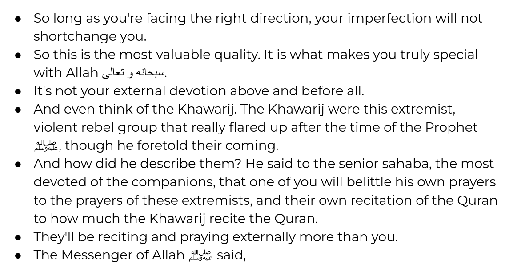

# Direction Not Perfection

MiniQ notes for Abdelrahman's F26 khaterah

---

Alsalamu alaikum wa rahmatullahi wabarakatuh

إن الحمد لله نحمده ونستعينه ونستغفره ونعوذ بالله من شرور أنفسنا ومن سيئات أعمالنا من يهده الله فلا مضل له ومن يضلل فلا هادي له..وأشهد ان لا إله إلا الله وحده لا شريك له وأشهد أن محمداً عبده ورسوله.

We'll keep it short inshallah because of the election results coming in right now but jazakumallhu khairan for coming today.

The title for today's MiniQ is Direction, Not Perfection. Which while it does rhyme and sound good it also is a central part of our religion and something important to remember.

In the Quran we find Sayidnah shuaib alayhi alsalam say to his people

>   وَاسْتَغْفِرُوا رَبَّكُمْ ثُمَّ تُوبُوا إِلَيْهِ ۚ إِنَّ رَبِّي رَحِيمٌ وَدُودٌ
>
>   So seek your Lord’s forgiveness and turn to Him in repentance. Surely my Lord is Most Merciful, All-Loving.” (11:90)

He is telling his people that they should turn back to Allah subhanahu wa tallah and that they will find mercy in Allah. Regardless of what you have previously done, regardless of how "bad" of a person that makes you, Allah will always be there for you to seek forgiveness and mercy from so don't let that "badness" stop you from thinking you're worthy of it. The act of turning back towards allah and seeking his forgiveness is incredibly important and means you're going in the right direction.

In surah al-buruj when the people persecuted the believers for their belief Allah says

>   إِنَّ ٱلَّذِينَ فَتَنُوا۟ ٱلْمُؤْمِنِينَ وَٱلْمُؤْمِنَـٰتِ ثُمَّ لَمْ يَتُوبُوا۟ فَلَهُمْ عَذَابُ جَهَنَّمَ وَلَهُمْ عَذَابُ ٱلْحَرِيقِ
>   
>   Those who persecute the believing men and women and then do not repent will certainly suffer the punishment of Hell and the torment of burning. (85:10)

"thuma lam yatooboo, then do not repent" means that had they repented, even with the oppression and the persecution and horrible things they were doing to the believers Allah subhanahu wa tallah still left his mercy open to them, so remember you are not some special exception, you're alhamdulillah doing what they're doing, you're listening a khaterah on a tuesday night Allah's mercy is always open and your past experiences don't change that. Two ayah's after allah subhanahu watallah says.

>   وَهُوَ ٱلْغَفُورُ ٱلْوَدُودُ
>
>   And He is the All-Forgiving, All-Loving— (85:14)

So now we understand that Allah's mercy is always open, we can always turn back to him, now what can we do to be as good of muslims as we can be. That part. Are we expected to be perfect doing everything possible with no mistake ever? NO. Definitely not. At the end of the day your a human, human's are weak and make mistakes all the time. So what's imporant is that we make sure that we strive for improvement and to make a positive change in our selves. We should love Allah subahanahu wa tallah and his messenger and use that as our compass. There is a hadith in saheeh bukhari that you've likely hear snippets of before that really explains that.

>   عَنْ أَنَسٍ ـ رضى الله عنه ـ أَنَّ رَجُلاً، سَأَلَ النَّبِيَّ صلى الله عليه وسلم عَنِ السَّاعَةِ، فَقَالَ مَتَى السَّاعَةُ قَالَ ‏"‏ وَمَاذَا أَعْدَدْتَ لَهَا ‏"‏‏.‏ قَالَ لاَ شَىْءَ إِلاَّ أَنِّي أُحِبُّ اللَّهَ وَرَسُولَهُ صلى الله عليه وسلم‏.‏ فَقَالَ ‏"‏ أَنْتَ مَعَ مَنْ أَحْبَبْتَ ‏"‏‏.‏ قَالَ أَنَسٌ فَمَا فَرِحْنَا بِشَىْءٍ فَرَحَنَا بِقَوْلِ النَّبِيِّ صلى الله عليه وسلم ‏"‏ أَنْتَ مَعَ مَنْ أَحْبَبْتَ ‏"‏‏.‏ قَالَ أَنَسٌ فَأَنَا أُحِبُّ النَّبِيَّ صلى الله عليه وسلم وَأَبَا بَكْرٍ وَعُمَرَ، وَأَرْجُو أَنْ أَكُونَ مَعَهُمْ بِحُبِّي إِيَّاهُمْ، وَإِنْ لَمْ أَعْمَلْ بِمِثْلِ أَعْمَالِهِمْ‏.‏
>   
>   Narrated Anas: A man asked the Prophet (ﷺ) about the Hour (i.e. Day of Judgment) saying, "When will the Hour be?" The Prophet (ﷺ) said, "What have you prepared for it?" The man said, "Nothing, except that I love Allah and His Apostle." The Prophet (ﷺ) said, "You will be with those whom you love." We had never been so glad as we were on hearing that saying of the Prophet (i.e., "You will be with those whom you love.") Therefore, I love the Prophet, Abu Bakr and `Umar, and I hope that I will be with them because of my love for them though my deeds are not similar to theirs.

Sahih al-Bukhari 3688

