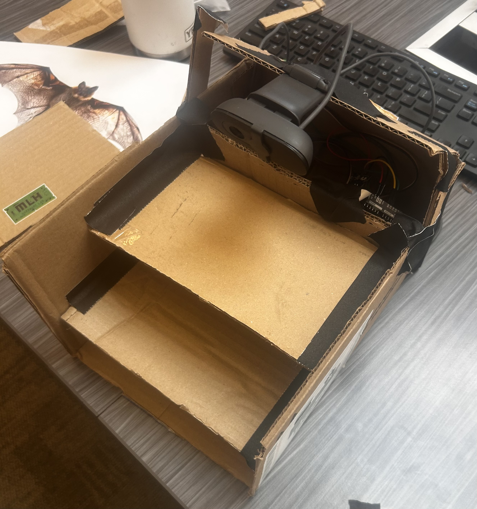
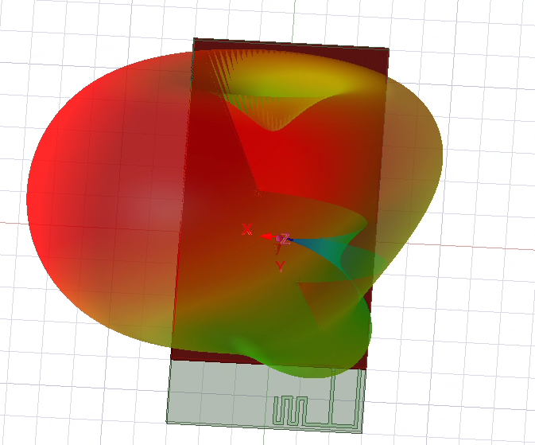
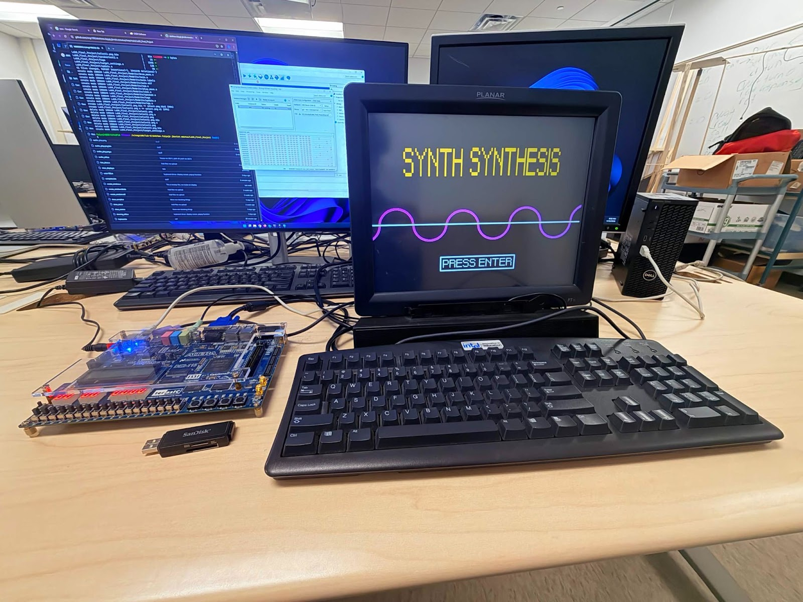
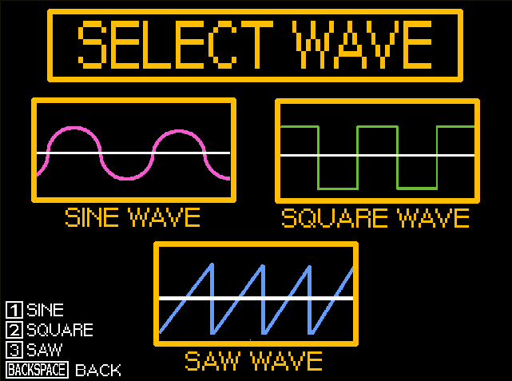
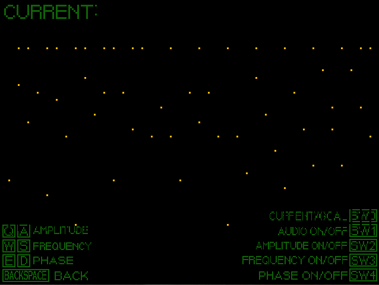
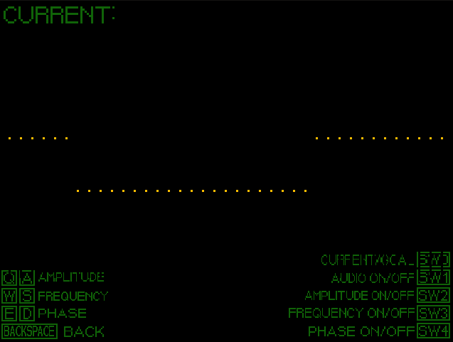
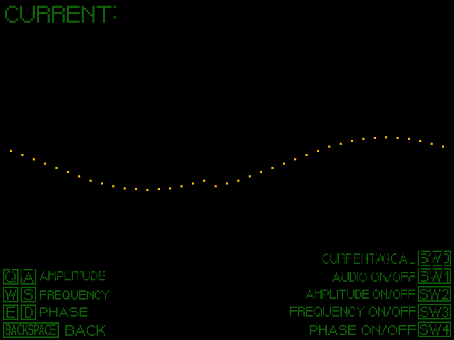
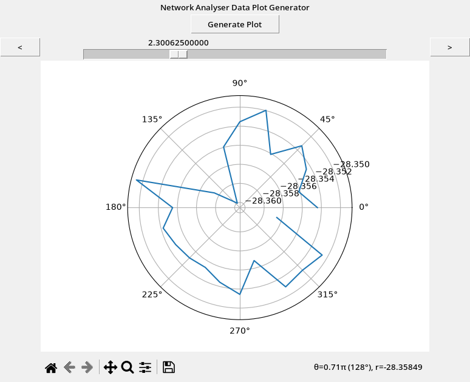

# Projects

Here are the things I've worked on!

---

If you prefer pdfs you can check out my formal [Samples of Work](./samples-of-work) document.

## Smart Sustainability Bat Box

```carousel



```

The **Smart Sustainability Bat Box** is a tool to help bat box owners better care for them, and allowing for better data collection for citizen's science efforts in support of bats and their roosting. On the dashboard found at [batbox.tech](https://batbox.tech) it provides live temperature, light, sound, and humidity sensors to then give owners maintenance and care advice when outside of the safe range for bats. It also uses computer vision in order to take photos of and time-stamp the bats as they enter and leave the bat box, making data collection simple, and also providing a live alert if the bats are sleeping on the outside of the bat box signaling something crucially wrong with the bat box.

The project was made as an entry into the sustainability track for the MHacks 2026: *Build Something That Grows* hackathon in the span of 24 hours with a team of four with the hardware provided to us by the competition and a limited selection of electronics brought by the team. The current information on the dashboard is based on sample data taken before the end of the hackathon to display.

### Goal

Citizen science efforts are some of the most important ways people can contribute to benefiting the environment. These efforts inspired us to create technology that can help improve these efforts and make them more effective. Tracking bat populations and creating man-made roosts is prevelant in many states such as Michigan and Alaska (bat boxes) in order to support and keep an eye on bats. Bats are facing large amounts of habitat loss and struggling due to climate change. Simultaneously, bats are a necessary and vital part of the ecosystem as they contribute to curbing insect populations, which can damage farmland and forests. With higher insect populations, farmers tend to use more pesticides and fertilizers, which get swept into our rivers and lakes, causing pollution and harming those ecosystems as well (e.g. Lake Erie’s algae blooms harming wildlife through toxin exposure and oxygen deprivation). While declining bat populations aren’t the only cause of such problems, making a difference where we can is the best thing we can do to help the environment.

### Result

<iframe width="560" height="315" src="https://www.youtube.com/embed/5mFW1SvJ1cE?si=VyvLCV-wwd90CY1i" title="YouTube video player" frameborder="0" allow="accelerometer; autoplay; clipboard-write; encrypted-media; gyroscope; picture-in-picture; web-share" referrerpolicy="strict-origin-when-cross-origin" allowfullscreen></iframe>

We used an Arduino UNO Q connected to a Logitech webcam running a bat detection image categorization neural network we trained using edge impulse. The box takes a photo every time it detects a bat, and sends it with a time-stamp to our Firebase real time database which then gets displayed by the dashboard. The UNO Q is then via its pins to the temperature, humidity, light, and sound sensors which get sent through serial and then also added into the json sent to the database. The bat box itself is put together with cardboard boxes from the Duderstadt center's loading dock and some duck tape, with the brains of it stored nicely at the top. The dashboard not only presents the data from the database, but will give recommended actions such as patching up gaps, or placing the box in a quieter location when the volume or light is too high. If the camera is seeing bats near the entrance for around 20 minutes it gives an urgent alert that the user should check in on the box since there is likely something vitally wrong with the box keeping the bats from going in.

## Bluetooth Antenna



### Goal

I was working on our R&D custom radio project for the Michigan Mars Rover team, and I wanted to learn how to use Ansys HFSS to simulate and design the project. I had in mind that I wanted to make a plant moisture sensor that then connected to another device via Bluetooth to give live alerts. So, the idea was that I was going to design and then simulate an antenna to optimize it and use it as my Bluetooth board for the project. While the plant project has been put off, (my plant died...) I fully designed the antenna.

### Result

I designed an inverted-F antenna in HFSS with a parameter for the length of the smaller horizontal segments which I then ran a simulation on in order to find the optimal value for when in the range of 2.4GHz. The result was that I had 90% efficiency over 100MHz of bandwidth to then transfer the data.

## Synth Synthesis

```carousel






```

**Synth Synthesis**, is an FPGA based toy built to introduce children to different wave modulations. It provides children with a variety of goal waveforms and sounds, that they then get to try and match. Children get to play around with and practice making different sounds to build an intution when it comes to making their own music.

### Goal

It's not necessarily easy to grasp synthesizer modulations when you're between 8 and 10 years old. Simultaneously lots of the online resources are either too specific to certain tools that they don't actually build an understanding, or they are too advanced for beginners. For our class ENGR100.250: Microprocessors and Toys, we were tasked with building an educational toy built off of an FPGA and this was our group's submission.

### Result

Throughout the class we built up the different pieces that finally allowed us to create this final project. We used Verilog (a hardware description language) to create our microprocessor with the capability of reading our assembly instruction set from the FPGA memory. We then used the assembly language to create drivers for a display, speaker, and keyboard which we then used to build our project. The project gives the user goal waves and the option to try different modulations and use them together. The user then tries to alter their initial starting wave to get the one presented to them. 

## 360° RF Test Analyzer



This was a tool I built while shadowing at Denso International America.

1. It automates the processing of 360° anechoic chamber readings from a vector network analyzer using python, organizing them by frequency and angle.
2. Then creates the GUI to generate polar plots at each of the 1601+ (with a larger range of frequencies can have even more) measured frequencies to inform decisions.
